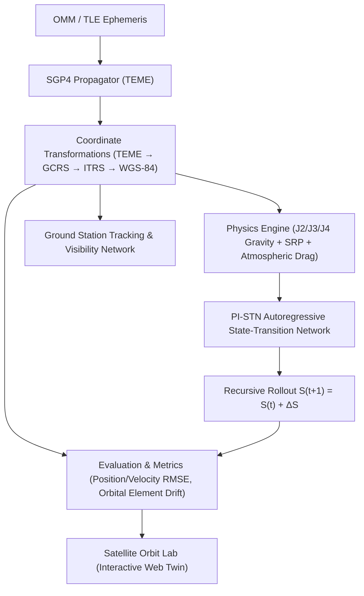

# Physics-Informed State Transition Network (PI-STN) for Satellite Orbital State Estimation and Prediction

[](https://www.python.org/downloads/)
[](https://pytorch.org/)
[](https://fastapi.tiangolo.com/)
[](https://react.dev/)
[](https://opensource.org/licenses/MIT)

An advanced physics-informed orbital mechanics and deep learning framework for satellite state estimation, orbit propagation, and perturbation prediction. The project couples analytical astrodynamics (SGP4), high-order gravitational and environmental disturbance modeling, and deep neural state-transition architectures (PI-STN) with an interactive digital twin dashboard: **Satellite Orbit Lab**.

---

## 🛰 System Architecture



---

## ✨ Key Features

1. **High-Fidelity Orbital Propagation**:
   - Automated ingestion of OMM and TLE orbital ephemeris.
   - Vectorized SGP4 propagation generating TEME state vectors.
   - Astropy-powered frame conversions: TEME $\rightarrow$ GCRS (inertial) $\rightarrow$ ITRS (Earth-fixed) $\rightarrow$ Geodetic (WGS-84).

2. **Perturbation Modeling & Physics Engine**:
   - Earth oblateness and zonal harmonics ($J_2, J_3, J_4$).
   - Solar radiation pressure (SRP) and atmospheric drag modeling.
   - Explicit energy ($\mathcal{E}$) and angular momentum ($\vec{h}$) conservation constraints.

3. **Physics-Informed State Transition Network (PI-STN)**:
   - Deep Residual MLP architecture learning non-linear discrete state transitions:
     $$S_{t+1} = S_t + \Delta S(S_t, \Delta t)$$
   - Simultaneous estimation of positions, velocities, and residual unmodeled accelerations:
     $$[\Delta x, \Delta y, \Delta z, \Delta v_x, \Delta v_y, \Delta v_z, a_{x,\text{res}}, a_{y,\text{res}}, a_{z,\text{res}}]$$
   - Autoregressive rollout initialized consistently at the OMM epoch.

4. **Satellite Orbit Lab Dashboard**:
   - **3D Inertial Orbit View**: Real-time 3D Earth and orbit visualization in GCRS space (Plotly WebGL).
   - **2D World Ground Track**: Interactive Leaflet map with antimeridian longitude splitting, dual trajectories (Reference vs. Prediction), and ground station passes.
   - **Live State Telemetry**: Continuous readout of position, velocity, and Keplerian orbital elements ($a, e, i, \Omega, \omega, \nu$).
   - **Prediction Comparison & Metrics**: Dynamic error growth curves, component residuals, and drift analysis.
   - **Synchronized Global Timeline**: Centralized time slider with playback controls (1x, 2x, 5x, 10x, 20x).

---

## 📁 Repository Structure

```
├── config.yaml                     # Master scientific configuration
├── environment.yml                 # Conda environment definition
├── requirements.txt                # Python scientific dependencies
├── checkpoints/                    # Trained neural network weights
│   ├── INSAT3D/best_model.pt       # PI-STN checkpoint for INSAT-3D
│   ├── GOES19/best_model.pt        # PI-STN checkpoint for GOES-19
│   └── GOES 16/                    # V1 PINN checkpoint for GOES-16
├── data/
│   ├── raw/omm/                    # Raw OMM orbital ephemeris text files
│   ├── metadata/                   # Mission specifications & ground station catalogs
│   └── processed/                  # Feature mappings & normalization statistics
├── src/                            # Scientific computation pipeline
│   ├── propagation/                # SGP4 propagator implementation
│   ├── coordinate_systems/         # TEME, GCRS, ITRS coordinate conversions
│   ├── ground_station/             # Station geometry, elevation & visibility passes
│   ├── observation_generation/     # Noisy observations & tracking radar synthesis
│   ├── physics/                    # J2/J3/J4 gravity, solar pressure & drag models
│   ├── pinn/                       # V1 PINN architectures
│   ├── pistn/                      # V2 PI-STN autoregressive neural networks
│   └── evaluation/                 # Metrics & orbital element drift calculators
└── dashboard/                      # Satellite Orbit Lab Web Application
    ├── start.py                    # Unified one-command launch script
    ├── requirements_dashboard.txt  # FastAPI & Uvicorn dependencies
    ├── backend/                    # FastAPI REST API & simulation services
    └── frontend/                   # React, Vite, TypeScript, TailwindCSS, Leaflet & Plotly
```

---

## 🚀 Quick Start Guide

### 1. Prerequisites
- Python 3.10+
- Node.js 18+ (optional if using pre-built dashboard bundle)
- Git

### 2. Installation

Clone the repository and set up a virtual environment:

```bash
git clone https://github.com/<YOUR_USERNAME>/Satellite_PINN_State_Estimation.git
cd Satellite_PINN_State_Estimation

# Create and activate virtual environment
python -m venv venv

# On Windows (PowerShell):
.\venv\Scripts\Activate.ps1
# On Linux / macOS:
source venv/bin/activate

# Install dependencies
pip install -r requirements.txt
pip install -r dashboard/requirements_dashboard.txt
```

### 3. Launching the Satellite Orbit Lab Dashboard

Run the unified startup script:

```bash
python dashboard/start.py
```

The interactive dashboard will be available at:
- **Web UI**: `http://localhost:8000` (or `http://localhost:5173` in development mode)
- **Interactive API Documentation**: `http://localhost:8000/docs`

---

## 📊 Scientific Verification & Metrics

The system has been verified across GEO satellites (**INSAT-3D**, **GOES-19**, and **GOES-16**) over 24-hour horizons:

- **Strict Initial-State Consistency**: Both SGP4 and PI-STN begin from the exact same GCRS state vector at the OMM epoch.
- **Continuous Metrics Evaluation**:
  - Position Root Mean Square Error (RMSE)
  - Velocity Root Mean Square Error (RMSE)
  - Keplerian Semi-Major Axis ($a$), Eccentricity ($e$), and Inclination ($i$) Drift
  - Cumulative Position Drift and Growth Rate

---

## 📜 Citation & License

This project was developed for satellite orbital state estimation research using physics-informed neural network architectures.

Released under the [MIT License](LICENSE).
